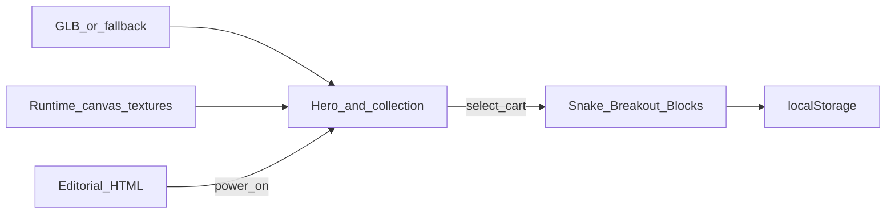

# 000 — Architecture snapshot

- **Repo:** `playroom`
- **Status:** current
- **Date:** 2026-09-10
- **Related:** [001-playroom-arcade.md](sdd/001-playroom-arcade.md)

## What it is

**Playroom** — a static browser arcade. Editorial HTML chrome over a Three.js product still (CRT, deck, pad, cart), then three playable games.

## Stack

| Layer | Choice |
| --- | --- |
| App | Vite, React 19, TypeScript |
| 3D | Three.js, `@react-three/fiber`, `@react-three/drei` |
| Hardware | Blender-authored GLBs in `public/models/` (`scripts/blender_hardware.py`); procedural fallback in `src/assets/hardware.ts` |
| Games | Canvas 2D + `localStorage` high scores |
| Deploy | GitHub Pages at `/playroom/`. `vercel.json` remains for a Vercel import |

## Data flow

View machine: `hero` → `powering` → `game` → `exiting` → `hero`. Power On dollies into the CRT; ← Desk reverses that shot (faster pull-back). Second Escape skips the exit.

## Source files

- `src/scene/` — camera rig, hero set, cables, collection, mascot
- `src/assets/` — GLB load + named-part fallback
- `src/textures/` — CRT idle pixels + cart labels
- `src/games/` — snake, breakout, blocks + shell
- `src/ui/` — letterbox, POWER ON, collection buttons
- `public/models/` — `crt.glb`, `console.glb`, `controller.glb`, `cartridge.glb`
- `blender/playroom_hardware.blend` — source still

## Deploy

GitHub Actions builds `dist/` and publishes it at `https://noowxela.github.io/playroom/`. Vite `base` is `/playroom/` only when `GITHUB_ACTIONS` is set. GLB URLs use that base. Local dev and preview stay at `/`. `vercel.json` is unchanged.
